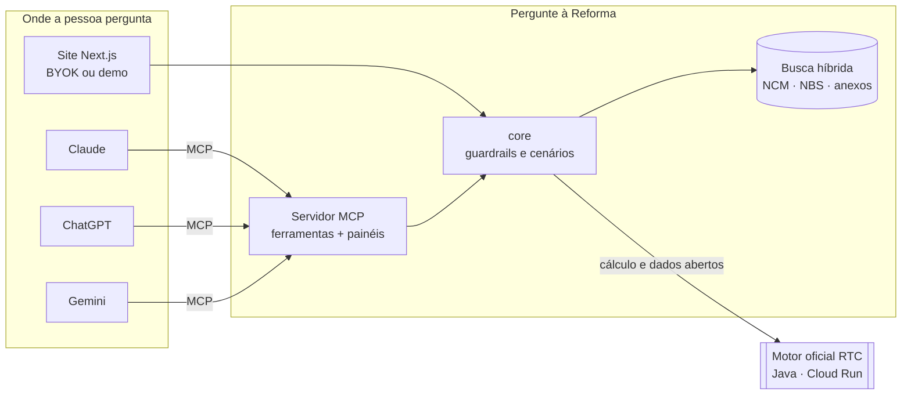

# Pergunte à Reforma

> Pergunte em português, receba o valor do imposto, a explicação e o artigo da **LC 214/2025**.
> A conta é sempre feita pelo **motor oficial da Receita Federal**, nunca pela IA.

**Status:** 🟢 Semana 1 quase concluída: motor oficial buildando e testado no CI, ETL e busca de NCM/NBS prontos (Bloco 2 · Projeto 1). Plano completo em [`docs/PLANO.md`](docs/PLANO.md) e tarefas nas [Issues](../../issues) e [Milestones](../../milestones).

---

## A ideia em 30 segundos

```
Você:  "Quanto de imposto tem num pacote de arroz de R$ 25 e numa cerveja de R$ 8?"

Agente: busca "arroz" → NCM 1006.30.21 → cesta básica (redução de 100%)
        busca "cerveja" → NCM 2203.00.00 → alíquota cheia + Imposto Seletivo
        chama o MOTOR OFICIAL → recebe os valores
        responde com os números do motor, o artigo da lei e um gráfico
```

O resultado não vem só em texto: aparece um **painel visual** com a memória de cálculo (base → redução → CBS → IBS → IS), a comparação entre os itens e o caminho da classificação ("por que deu isso").

## Use com a IA que você já tem

Em vez de cobrar uma API de IA do projeto, **você usa o seu próprio Claude, ChatGPT ou Gemini**:

| Modo | Como funciona | Quem paga o modelo |
|---|---|---|
| **1. Conector (principal)** | Cole a URL do servidor MCP em *Conectores* do Claude, *Apps* do ChatGPT ou *Connected Apps* do Gemini. As ferramentas e os painéis visuais aparecem dentro do chat que você já usa. | A sua assinatura |
| **2. Site com sua chave** | No site, escolha Claude, GPT ou Gemini e cole sua chave de API. Ela fica só no seu navegador. | A sua chave |
| **3. Demonstração grátis** | Algumas perguntas por dia com um modelo leve, para quem só quer testar. | O projeto (com limite) |

> **Por que não "entrar com a conta do Claude/ChatGPT/Gemini" dentro do site?** Os termos de uso da Anthropic e do Google proíbem que apps de terceiros usem o login da assinatura do usuário (e contas já foram bloqueadas por isso). O conector MCP inverte a lógica: **o projeto entra na sua conta**, não o contrário. Detalhes em [ADR-001](docs/adr/ADR-001-modelo-do-usuario-via-mcp.md).

## Arquitetura



Mais detalhes em [`docs/ARQUITETURA.md`](docs/ARQUITETURA.md).

## Princípios inegociáveis

1. **A IA não faz conta.** Todo número exibido vem da resposta do motor oficial ([ADR-002](docs/adr/ADR-002-ia-nao-faz-conta.md)).
2. **Toda resposta cita a lei**: artigo da LC 214/2025 e a classificação usada (CST/cClassTrib).
3. **Na dúvida, pergunta.** Se o produto cabe em duas classificações, o agente pergunta em vez de chutar.
4. **Simulação, não consultoria.** O aviso aparece em toda resposta. A partir de 2027 as alíquotas são cenários configuráveis e isso fica explícito.
5. **Medido, não prometido.** A taxa de acerto é medida contra os casos de teste oficiais do repositório da Receita ([`docs/AVALIACAO.md`](docs/AVALIACAO.md)).

## Rodando na sua máquina

**No Windows, sem terminal:** baixe o arquivo [`Iniciar Pergunte a Reforma.cmd`](Iniciar%20Pergunte%20a%20Reforma.cmd) e dê dois cliques. Na primeira vez ele baixa o projeto em `%USERPROFILE%\pergunte-a-reforma`, oferece instalar pelo winget o que faltar (Git, Node 22 e Java 21), baixa o motor oficial e compila o site. Depois abre `http://localhost:3000`. Ele também pergunta se o app deve ligar sozinho quando você entrar no Windows; para desfazer, apague o atalho em `shell:startup`. Fechar a janela desliga tudo.

**Pelo terminal (qualquer sistema).** Precisa de **Node 22+**, **pnpm**, **Java 21** e **git**.

```bash
pnpm install
pnpm local              # baixa o motor oficial (só na 1ª vez), liga o motor e o site
# ou: pnpm local:simulado  → o chat usa um modelo simulado, sem chave de IA
# ou: node scripts/local.mjs --producao --abrir   → versão compilada (mais leve), abre o navegador
```

Se algo der errado, a mensagem diz o quê:
- porta 8080 ou 3000 ocupada;
- download que caiu, que é retomado e conferido pelo SHA-256 na próxima vez;
- motor que não ligou, com detalhes em `.motor/motor.log`.

Se o site já estiver no ar, um segundo início só abre o navegador. Fechar a janela, ou o site parar, desliga o motor junto.

Abra **http://localhost:3000**. A busca de produtos e o cálculo funcionam sem IA; para perguntas livres, informe a sua chave (Claude, OpenAI ou Gemini) na tela. Ela fica só na memória da aba. O conector MCP fica em `http://localhost:3000/mcp`.

Outros comandos úteis:

```bash
pnpm -r test                               # core, conector MCP e chat do site (motor simulado com respostas reais gravadas)
pnpm --filter @reforma/search avaliar      # mede a busca no gabarito
RTC_ENGINE_URL=http://localhost:8080/api pnpm --filter @reforma/eval oficiais   # casos oficiais da Receita
```

## Estrutura do repositório

```
engine/          Dockerfile do motor oficial (Java 21 + SQLite gerado no build)
packages/core/   cliente do motor, ferramentas, cenários, guardrails (TypeScript)
packages/search/ ETL dos dados abertos + índice de busca NCM/NBS/anexos
apps/mcp/        servidor MCP remoto + painéis visuais (MCP Apps)
apps/web/        site Next.js: chat BYOK/demo + painéis
eval/            gabarito a partir dos testes oficiais + runner de avaliação
docs/            plano, arquitetura, ideias, ADRs, posts
```

## Créditos e aviso

- Motor de cálculo: [ReceitaFederal/calculadora-rtc-regime-regular](https://github.com/ReceitaFederal/calculadora-rtc-regime-regular) (licença MIT), usado sem modificações.
- Projeto independente, sem vínculo com a Receita Federal ou o SERPRO. **É uma simulação e não substitui orientação de um contador.**

Feito por [Nicolas Santos](https://www.linkedin.com/in/nicolassantos-986861304) · Licença MIT
