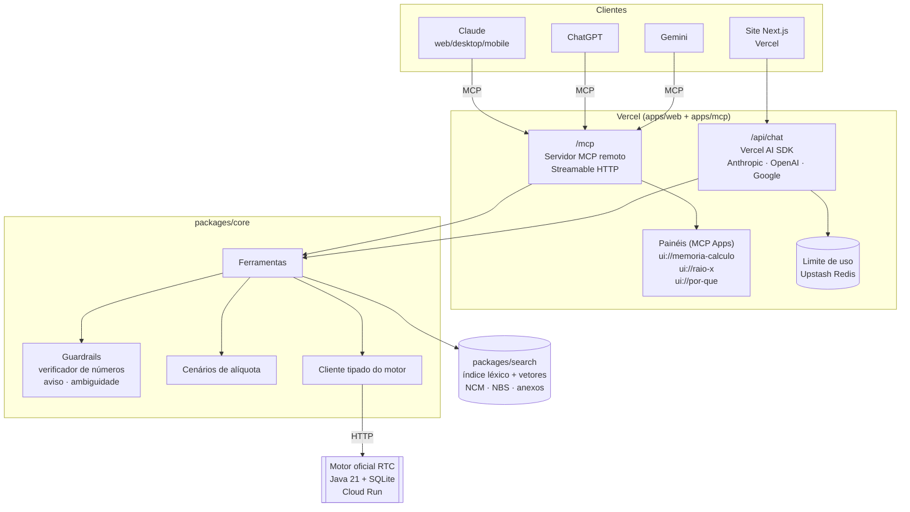

# Arquitetura

## Visão geral



## Componentes

### `engine/` — motor oficial
- Imagem Docker de dois estágios: clona a tag fixada (`RTC_REF`), roda o Flyway para **gerar o SQLite no build** e empacota o JAR. A imagem final tem só JRE, JAR e banco.
- Cloud Run em `southamerica-east1`, `min-instances=0`, `max-instances=2`, *startup CPU boost*.
- Endpoints usados:
  - `POST /api/calculadora/observabilidade/regime-geral`: cálculo com erro por item (não derruba a operação inteira)
  - `GET /api/calculadora/observabilidade/erros?codigo=REG-011`: descrição oficial do erro
  - `GET /api/calculadora/dados-abertos/{ncm, nbs, classificacoes-tributarias/*, fundamentacoes-legais, aliquota-*}`: dados para ETL e fundamentação
- O motor **não é exposto ao usuário final**: só o `core` chama.

### `packages/search/` — busca por linguagem natural
- **ETL** (roda no build): baixa NCM, NBS, cClassTrib e vínculos NCM/NBS↔cClassTrib dos dados abertos do próprio motor.
- **Texto enriquecido:** a descrição de NCM é hierárquica e curta ("-- Outros"). O texto indexado junta capítulo > posição > subposição > item, mais sinônimos populares (`arroz` → "arroz semibranqueado ou branqueado").
- **Busca híbrida:** léxica (BM25 com normalização de acentos e radicais em PT) + semântica (embeddings multilíngues gerados localmente com transformers.js), com fusão por *reciprocal rank fusion*.
- **Saída:** top-5 candidatos com código, descrição, cClassTrib possíveis, anexo da LC 214 e um `nivelConfianca`. Se os dois primeiros estiverem próximos ou houver mais de um cClassTrib, marca `ambiguo: true`.

### `packages/core/` — ferramentas e regras
Contratos em [`packages/core/src/contracts.ts`](../packages/core/src/contracts.ts).

| Ferramenta | O que faz | Painel |
|---|---|---|
| `buscar_produto(texto)` | Texto livre → candidatos NCM/NBS + classificação provável | — |
| `calcular_tributos(operacao)` | Chama o motor e devolve valores + memória de cálculo estruturada | Memória de cálculo |
| `comparar_itens(itens[])` | Vários itens numa operação ("carrinho") | Raio-X do carrinho |
| `buscar_fundamentacao(cClassTrib)` | Artigo, inciso, anexo e link para a LC 214/2025 | Por que essa classificação |
| `explicar_erro(codigo)` | Traduz `REG-xxx` para português simples + o que fazer | — |

**Cenários de alíquota:** em 2026 o motor usa as alíquotas de teste. A partir de 2027 a API exige `aliquotasNominais`, então cada cálculo recebe um `cenario` nomeado (ex.: `referencia-estimada`, `personalizado`) e esse nome volta na resposta e no painel.

**Guardrails:**
1. **Proveniência dos números:** toda ferramenta devolve `valores` com um `idCalculo`. No site, o verificador extrai os números da resposta do modelo e bloqueia ou reescreve qualquer número monetário ou percentual que não esteja nos resultados das ferramentas daquela conversa.
2. **Aviso obrigatório:** "Simulação educativa, não é consultoria tributária." É injetado pelo servidor, não depende do modelo.
3. **Ambiguidade:** se `ambiguo: true`, a ferramenta de cálculo recusa e devolve a pergunta que o modelo deve fazer.
4. **Citação:** `calcular_tributos` já anexa a fundamentação do cClassTrib, então o modelo sempre recebe o artigo.

### `apps/mcp/` — servidor MCP remoto
- Transporte Streamable HTTP, sem autenticação no MVP (as ferramentas são públicas e somente leitura) e com limite por IP.
- **MCP Apps:** cada ferramenta com painel declara um recurso `ui://...`. Clientes compatíveis (Claude, ChatGPT, VS Code) mostram o painel interativo, e os outros recebem texto completo.
- `structuredContent` com os números oficiais + `content` em texto com instruções ("use exatamente estes valores; cite o artigo; inclua o aviso").
- Pode rodar como rota `/mcp` dentro do Next.js (um deploy só) ou como serviço separado. Decisão na issue de implementação.

### `apps/web/` — site
- Next.js (App Router) na Vercel.
- **Seletor de provedor:** Claude, GPT ou Gemini via Vercel AI SDK (mesma definição de ferramentas para os três).
- **BYOK:** a chave fica no `sessionStorage` do navegador, vai no cabeçalho da requisição e **nunca é registrada em log nem salva**.
- **Demo:** modelo leve do Gemini com limite por IP e teto mensal.
- Os **mesmos componentes de painel** do MCP são renderizados ao lado do chat.

### `eval/`
Ver [`AVALIACAO.md`](AVALIACAO.md).

## Fluxo de dados de um cálculo

```
pergunta → modelo → buscar_produto → (ambíguo? pergunta) → calcular_tributos
         → core monta OperacaoRTC (data, UF, município, cenário)
         → motor /observabilidade/regime-geral
         → core normaliza: valores, memória, estadoItem, erros
         → buscar_fundamentacao(cClassTrib) anexada
         → resposta (texto + structuredContent + ui://)
         → [site] verificador de números → usuário
```

## Decisões registradas
- [ADR-001 — Modelo do usuário via conector MCP, não via login de assinatura](adr/ADR-001-modelo-do-usuario-via-mcp.md)
- [ADR-002 — A IA não faz conta](adr/ADR-002-ia-nao-faz-conta.md)
- [ADR-003 — Busca híbrida local em vez de banco vetorial](adr/ADR-003-busca-hibrida-local.md)
- [ADR-004 — Monorepo TypeScript](adr/ADR-004-typescript-monorepo.md)
