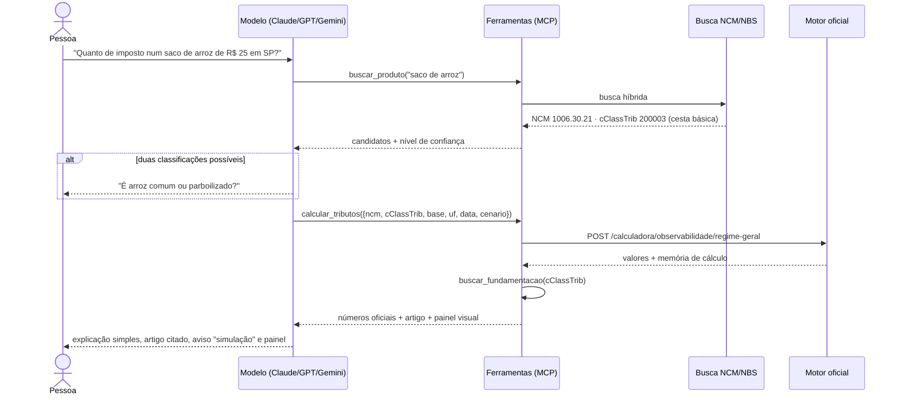

# Plano do projeto — Pergunte à Reforma

**Bloco 2 · Projeto 1** · Prazo: 4 semanas (início em 17/11/2026, lançamento previsto na semana de 15/12/2026)

## 1. Objetivo

A pessoa pergunta em português ("quanto de imposto tem no arroz?") e recebe:

1. o **valor do imposto** (CBS, IBS e, quando houver, Imposto Seletivo), calculado pelo motor oficial;
2. uma **explicação simples** de por que deu aquele valor;
3. o **artigo da LC 214/2025** que fundamenta a classificação;
4. um **painel visual** (memória de cálculo, comparação, cenário), não só texto.

### O que mudou em relação à ideia original

| Ideia original | Agora | Por quê |
|---|---|---|
| Agente com Gemini via API, pago pelo projeto | **O usuário usa o próprio Claude, ChatGPT ou Gemini** (conector MCP), com site BYOK e demo grátis limitada como alternativas | Custo zero de IA para o projeto e alcance nos três ecossistemas |
| "Login com a conta do Claude/GPT/Gemini" no site | **Não fazer.** Usar conector MCP | Anthropic e Google proíbem o uso do login de assinatura em apps de terceiros ([ADR-001](adr/ADR-001-modelo-do-usuario-via-mcp.md)) |
| Chatbot com texto | **Painéis visuais interativos** dentro do chat (MCP Apps) e no site | Diferencial para o post e para quem usa |
| Python ou Node | **TypeScript em tudo** (fora o motor Java) | Os SDKs de MCP e MCP Apps são TypeScript-first, e o site é Next.js ([ADR-004](adr/ADR-004-typescript-monorepo.md)) |
| Base vetorial no Databricks ou pgvector | **Índice local** (léxico + embeddings pré-calculados), sem banco externo | São só ~12 mil códigos, cabe na memória e não gera custo por consulta ([ADR-003](adr/ADR-003-busca-hibrida-local.md)) |

## 2. Escopo

### Dentro (MVP)
- Motor oficial no Cloud Run (versão fixada, hoje a tag `1.6.1`).
- Busca em linguagem natural para NCM, NBS e itens dos anexos.
- Ferramentas: `buscar_produto`, `calcular_tributos`, `buscar_fundamentacao`, `explicar_erro`, `comparar_itens`.
- Servidor MCP remoto funcionando no Claude, no ChatGPT e no Gemini.
- 3 painéis visuais: **Memória de cálculo**, **Raio-X do carrinho** e **Por que essa classificação**.
- Site Next.js com modo BYOK e demo com limite.
- Avaliação automática com os casos de teste oficiais e taxa de acerto publicada.

### Fora (por enquanto)
- Simples Nacional (repositório separado da Receita; pode virar a v2).
- Contas de usuário, histórico salvo, pagamentos.
- Comparação com o sistema atual (ICMS/PIS/Cofins): o motor oficial não calcula isso e a IA não pode inventar.

## 3. Como funciona uma pergunta

## 4. Etapas (4 semanas)

Cada etapa é uma **Milestone** no GitHub e cada item é uma **Issue**.

### Semana 1 — Motor no ar e base de busca (17 a 23/11)
- [ ] Monorepo TypeScript (pnpm workspaces, lint, CI básico)
- [ ] Motor: build local validado (Flyway gera o SQLite, o JAR sobe no perfil `offline`)
- [ ] Motor: deploy no Cloud Run (`southamerica-east1`, min 0, máx. 2 instâncias, *startup CPU boost*)
- [ ] ETL: baixar NCM, NBS, cClassTrib, NCM/NBS aplicáveis e fundamentações pelos endpoints `/dados-abertos/*` → `data/*.json`
- [ ] Busca híbrida + 50 consultas de teste ("arroz", "cerveja", "mensalidade escolar", "remédio para pressão"...)

**Pronto quando:** `curl` no Cloud Run calcula o exemplo oficial, e a busca acerta o NCM em pelo menos 80% das 50 consultas (top-3).

### Semana 2 — Ferramentas, guardrails e conector MCP (24 a 30/11)
- [ ] `packages/core`: cliente tipado do motor (zod) e montagem da operação
- [ ] As 5 ferramentas do MVP
- [ ] Cenários de alíquota: `teste-2026` (oficial) e cenários configuráveis para 2027 em diante
- [ ] Guardrails: verificador de números, aviso obrigatório, detecção de ambiguidade
- [ ] Servidor MCP remoto (Streamable HTTP) + passo a passo para conectar no Claude, ChatGPT e Gemini
- [ ] Runner de avaliação v0

**Pronto quando:** a mesma pergunta funciona nos três chats e o runner roda os casos oficiais de ponta a ponta.

### Semana 3 — Além do chat: painéis e site (01 a 07/12)
- [ ] Painel **Memória de cálculo** (cascata: preço → base → redução → CBS → IBS → IS)
- [ ] Painel **Raio-X do carrinho** (vários itens, quem tem redução, total de tributos)
- [ ] Painel **Por que essa classificação** (texto → NCM → anexo → cClassTrib → artigo)
- [ ] Site Next.js: seletor de provedor, BYOK e demo
- [ ] Limite de uso e controle de custo da demo

**Pronto quando:** os painéis aparecem dentro do Claude e do ChatGPT e no site, com os mesmos componentes.

### Semana 4 — Avaliação, polimento e lançamento (08 a 14/12)
- [ ] Avaliação completa nos 3 provedores + página pública `/avaliacao`
- [ ] README final, GIF e vídeo do agente respondendo
- [ ] Post 1: "Construí o que a Receita está avaliando para 2027"
- [ ] Post 2: "Por que a IA não faz a conta" (com a taxa de acerto)

**Pronto quando:** link público estável, vídeo gravado e os dois posts agendados.

### Depois do lançamento (backlog)
Ideias extras em [`IDEIAS-ALEM-DO-CHAT.md`](IDEIAS-ALEM-DO-CHAT.md): linha do tempo da transição 2026–2033, preço reverso, gerador do XML do grupo IBS/CBS, leitura de XML da NF-e, card para compartilhar e exportação em PDF.

## 5. Riscos e como lidar

| Risco | Impacto | Plano |
|---|---|---|
| Busca escolhe o NCM errado | Valor errado com aparência de certo | Mostrar a classificação usada, perguntar quando a confiança for baixa, medir top-1 e top-3 |
| Modelo do usuário "arredonda" ou inventa números no texto | Quebra a promessa central | No site: verificador bloqueia números que não vieram do motor. No MCP: o painel mostra os números oficiais e a ferramenta devolve instruções explícitas |
| Alíquotas de 2027+ ainda não definidas | Resultado parece oficial sem ser | Cenários nomeados ("cenário de referência estimado") e aviso em destaque |
| Cold start do Java no Cloud Run | Primeira resposta lenta (~10–20 s) | *Startup CPU boost*, `min-instances=1` só na semana de lançamento, ping de aquecimento |
| Abuso da demo grátis | Custo do Gemini | Limite por IP e por dia, teto mensal, modelo leve, desligar a demo sem quebrar o resto |
| Motor oficial muda (nova release) | Testes quebram | Versão fixada por tag, atualização via PR com a avaliação rodando no CI |
| Suporte a MCP Apps varia entre os chats | Painel não aparece em algum cliente | Sempre devolver também texto completo, porque o painel é um extra |
| Já existem projetos parecidos (servidor MCP da calculadora, Skill de auditoria) | Menos novidade | Nosso diferencial: busca por linguagem natural, painéis visuais, avaliação pública e três provedores comparados |

## 6. Custos estimados (mensal)

| Item | Estimativa |
|---|---|
| Cloud Run (min 0, pouco tráfego) | ~R$ 0–30 (cota grátis cobre boa parte) |
| Vercel (Hobby) | R$ 0 |
| Modelos de IA no modo conector ou BYOK | R$ 0 para o projeto |
| Demo grátis (modelo leve com limite) | Teto configurável, ex.: US$ 5/mês |
| Embeddings | R$ 0 (modelo local, gerado no build) |

## 7. Definição de pronto (projeto)

- [ ] Funciona no Claude, ChatGPT, Gemini e no site
- [ ] 0 números no texto que não vieram do motor (medido)
- [ ] Taxa de acerto publicada e reproduzível com um comando
- [ ] README em que qualquer pessoa consegue rodar tudo localmente em menos de 10 minutos
- [ ] Vídeo e posts publicados
